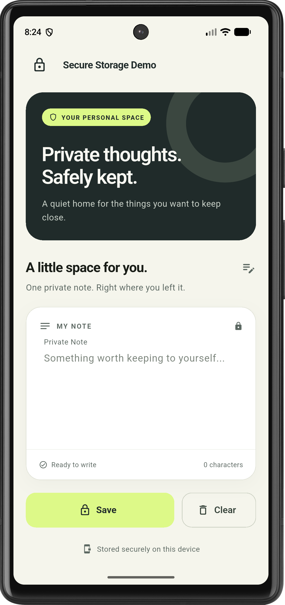

# 🔐 Secure Note — Flutter Local Storage Lab

A Flutter app that keeps **one private note** encrypted on the device using
[`flutter_secure_storage`](https://pub.dev/packages/flutter_secure_storage).
Type a note, save it, close the app, and it is still there when you come back —
stored in the Android Keystore / iOS Keychain instead of plain-text preferences.

Built for **Lab Task 07 — Flutter Packages, Local Storage and Application Data**
(CS-314 Mobile Application Development Lab) — prepared by **Azha Khan**.

<p>
  
  
  
  
  
</p>

---

## 📱 Screenshot

<p align="center">
  
</p>

<p align="center"><em>Running on an Android device — empty editor, ready to write.</em></p>

---

## ✅ What we did in this lab

1. **Added a third-party package** — declared `flutter_secure_storage: ^11.2.0` in
   `pubspec.yaml` and committed `pubspec.lock` so every checkout resolves the same versions.
2. **Evaluated the package** on pub.dev (publisher, platforms, license, SDK
   constraints, documentation) — see [`docs/lab_notes.md`](docs/lab_notes.md).
3. **Wrapped storage in a service** — `SecureStorageService` is the only class that
   touches the package, exposing `saveNote`, `readNote` and `deleteNote` on a single
   key (`private_note`).
4. **Built the UI** — a Material 3 screen with a multiline editor, character count,
   unsaved-changes indicator, Save / Clear buttons and SnackBar feedback.
5. **Handled failures** — if secure storage is unavailable the draft stays editable,
   failed saves keep the text, and a **Retry storage** action is offered.
6. **Configured each platform** — Android `minSdk 23` with auto-backup disabled,
   Keychain access-group entitlements for iOS/macOS.
7. **Wrote widget tests** with mocked storage for the save → reload → clear flow
   and for storage-failure behaviour.
8. **Compared storage options** (Shared Preferences vs Secure Storage vs Local
   Database vs Cloud) — see [`docs/storage_comparison.md`](docs/storage_comparison.md).

## ✨ Features

- Multiline private note that loads automatically on app start
- Encrypted persistence via Keystore (Android) / Keychain (iOS, macOS)
- Save replaces the previous note; Clear deletes it from storage
- Live character count, unsaved-changes status and save confirmation
- Graceful error handling with draft preservation and retry
- Warm ivory, deep green and lime Material 3 theme
- Plain `StatefulWidget` state — no state-management package needed

## 🛠️ Tech stack

| Area | Technology |
| --- | --- |
| Framework | Flutter (Material 3) |
| Language | Dart `^3.13.4` |
| Secure storage | `flutter_secure_storage` 11.2.0 (Android Keystore, Apple Keychain, libsecret, Windows Credential Manager) |
| State management | `StatefulWidget` + `setState` |
| Icons | Material Icons, `cupertino_icons` |
| Testing | `flutter_test` with mocked secure storage |
| Linting | `flutter_lints` 6 |
| Build | Gradle (Android debug APK) |

## 🧱 Architecture

```text
SecureNoteScreen (UI + state)
        │  saveNote / readNote / deleteNote
        ▼
SecureStorageService  ──►  FlutterSecureStorage  ──►  Keystore / Keychain
```

```text
lib/
  main.dart                              # App entry point and Material 3 theme
  screens/secure_note_screen.dart        # Editor UI and screen state
  services/secure_storage_service.dart   # Secure write, read and delete
test/
  widget_test.dart                       # Save → reload → clear flow
  storage_failure_test.dart              # Editable draft and retry on failure
docs/
  lab_notes.md                           # Package evaluation and viva answers
  storage_comparison.md                  # When to use which storage option
  *_output.txt                           # Saved analyze / test / build logs
  screenshots/                           # App screenshots
```

## 🚀 Getting started

Requirements: Flutter SDK (Dart ^3.13.4), Android SDK, and an Android device or emulator.

```bash
git clone https://github.com/Anas-Khannn/flutter_Packages-_local_storage.git
cd flutter_Packages-_local_storage
flutter pub get
flutter run
```

> After adding or updating a native plugin, fully stop and re-run the app —
> hot restart does not rebuild the platform code.

### Using the app

1. Type into **Private Note**.
2. Tap **Save** and wait for *Note saved securely*.
3. Close and reopen the app — the note is restored.
4. Edit and save again to replace it.
5. Tap **Clear** to delete the stored note.

## 🧪 Verification

| Command | Result |
| --- | --- |
| `flutter analyze` | No issues found |
| `flutter test` | All 4 tests passed |
| `flutter build apk --debug` | `app-debug.apk` built successfully |

Full logs are in [`docs/`](docs). Tests use an in-memory mock, so on-device
persistence should be confirmed manually on a real device. iOS, macOS, Linux, Windows and web
builds have not been verified.

## 🌍 Platform notes

- **Android:** API 23+; auto-backup disabled so secrets are not copied off-device.
- **iOS / macOS:** Keychain access groups configured; signing must be checked on a Mac.
- **Windows:** Requires Visual Studio C++ tools and ATL.
- **Linux:** Requires `libsecret` and a running keyring service.
- **Web:** Experimental; needs HTTPS or localhost.

See the [package README](https://pub.dev/packages/flutter_secure_storage/versions/11.2.0)
for full platform requirements.

## 📚 Lab documentation

- [Lab notes, package evaluation and viva answers](docs/lab_notes.md)
- [Storage comparison](docs/storage_comparison.md)
